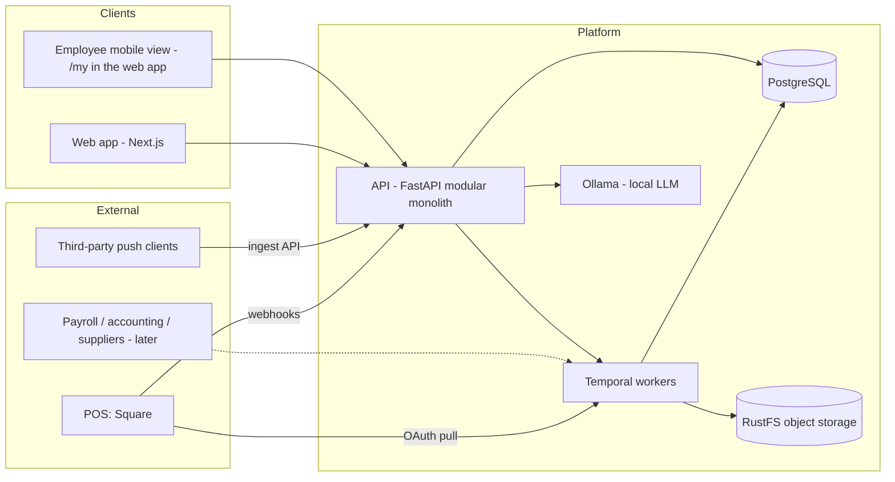

# Architecture

**Status:** Draft · **Last updated:** 2026-10-20
**Related:** [PRD](prd.md), [ADR 0002: Production stack](adr/0002-production-stack.md), [ADR 0004: Mobile as a responsive web view](adr/0004-mobile-as-responsive-web.md), [Integration layer](specs/integration-layer.md), [Sous](specs/sous.md)

## Overview

A multi-tenant SaaS design: one modular-monolith API, one PostgreSQL source of truth, and durable workers for integrations and long-running jobs. External systems feed a shared canonical model, and every module and Sous reads from that model.

It runs entirely locally under Docker Compose at zero cost ([ADR 0002](adr/0002-production-stack.md)). Cloud services are replaced by local equivalents behind the same interfaces.



## Modules

The API is one deployable, organized by module. Each module is a package under `apps/api/app/` with `api.py` (routes: auth, role and location checks, request parsing), `service.py` and topic files (logic and queries), `models.py` and `schemas.py`. All modules share one PostgreSQL database and RLS.

Boundaries are enforced by `apps/api/tests/test_boundaries.py` ([spec](specs/backend-module-boundaries.md)):

- **Platform** (`config`, `db`, `errors`, `ids`, `context`, `formatting`, `telemetry`, `business_date`) imports no module code.
- **Composition roots** (`main`, `cli`, `health`, `models`) wire modules together. Only roots import them.
- A module reaches another only through the submodules listed in that module's `PUBLIC` tuple (`app/<module>/__init__.py`), and never through its `api` routers.
- Module cycles fail the test. Four existing two-way links are allowlisted: security ↔ identity, commerce ↔ integrations, team ↔ integrations, integrations ↔ workflows. An allowlisted edge that disappears also fails the test, so the list can only shrink.

| Module | Owns |
| --- | --- |
| **identity** | Organizations, locations, users, memberships and roles, API keys |
| **security** | Sessions and CSRF, password policy, login throttling, key provider |
| **integrations** | Connections, sync state, raw records, identity mapping, freshness ([spec](specs/integration-layer.md)) |
| **commerce** | Sales orders and lines, menu items, daily sales read models, reports |
| **team** | Employees, positions, invitations, notifications; `scheduling/` (builder, forecast, attendance); `requests/` (availability and time off, open-shift coverage, trades); timecards and tasks |
| **inventory** | Items, packs and units, pars, counts, suppliers, purchase orders, receiving, recipes, waste, food cost variance, transfers |
| **sous** | Daily briefing, conversations, schedule proposals; `agent/` (orchestration, model client, prompt, tools, grounding checks) ([spec](specs/sous.md)) |
| **workflows** | Temporal client, worker, and workflow definitions |
| **audit** | Append-only audit events |

## Data flow

1. **Ingest.** The integrations module pulls from connected systems on a schedule, takes webhooks as triggers, and accepts pushes. Raw payloads are stored before any transformation.
2. **Normalize.** Provider-specific normalizers map raw records onto canonical entities owned by commerce and team. External IDs resolve through `external_refs`. Records that can't be resolved raise mapping issues instead of being dropped.
3. **Derive.** Read models (`daily_sales`, `daily_labor`) are rebuilt for each affected location and business date. Domain events notify interested modules.
4. **Serve.** Module APIs serve the web and mobile clients. Any response built on imported data carries a `DataFreshness` block.
5. **Assist.** Sous calls the same module services through typed tools and carries their freshness through to its answers.

## Core domain model

```
Organization 1─* Location 1─* {Employee, Shift, Timecard, SalesOrder, InventoryLevel, Count, PurchaseOrder, WasteEntry}
Organization 1─* {User, Supplier, Item, Recipe, MenuItem, IntegrationConnection, ApiKey}
MenuItem *─0..1 Recipe *─* Item (via RecipeIngredient, with units)
SalesOrder 1─* SalesOrderLine *─0..1 MenuItemVariant
Employee 0..1─1 User      (employees may not have logins)
IntegrationConnection 1─* LocationLink ─1 Location
ExternalRef: (connection, entity_type, external_id) → canonical entity
```

Conventions:

- IDs are UUIDv7. Money is integer minor units plus currency. Times are `timestamptz` (stored in UTC).
- **Business date** is a first-class column on operational records, computed from the location's timezone and day-start time (default 04:00).
- Records from external systems keep `source` and `source_version`.

## Tenancy, auth, and authorization

- Every table carries `org_id`. Location-scoped tables also carry `location_id`.
- Scope is derived from the authenticated session or API key on every request. It is never accepted from request bodies or model output.
- Enforcement happens twice: in the service layer (explicit scope parameters on every query) and in PostgreSQL row-level security keyed on a per-transaction `app.org_id` setting.
- Background jobs carry org scope in their workflow input and set it on every DB transaction.
- Web sessions use HttpOnly SameSite cookies plus CSRF tokens. The employee mobile view is part of the web app and uses the same sessions ([ADR 0004](adr/0004-mobile-as-responsive-web.md)); a native client would add short-lived access tokens plus refresh tokens. Integrations use scoped API keys (hashed at rest, shown once).
- Roles: `owner`/`admin` see every location, `manager` the locations in `location_access`, `employee` only `/v1/me/*`, notifications, and the published team schedule (Commerce, Sous, Integrations, and Team management return 403).

## Tech stack

See [ADR 0002](adr/0002-production-stack.md) for the decision and rationale.

| Layer | Technology | Local runtime |
| --- | --- | --- |
| Web | Next.js, React, TypeScript | `next dev` |
| Mobile | Employee view in the web app (`/my`), home-screen installable ([ADR 0004](adr/0004-mobile-as-responsive-web.md)). Expo deferred | `next dev` |
| API | Python, FastAPI, Pydantic | `uvicorn` container |
| Database | PostgreSQL (RLS enabled) | `postgres` container |
| Workflows | Temporal, Python workers | Temporal dev server container |
| Files | S3 API | RustFS container (S3-compatible; MinIO no longer publishes images) |
| Secrets | Envelope encryption via `KeyProvider` | AES-GCM key from `.env` |
| LLM | `LLMProvider` interface | Ollama |
| Observability | OpenTelemetry traces, structured logs, metrics | OTel Collector + Jaeger containers |
| Orchestration | Docker Compose | `docker compose up` |

## Observability

- Traces span API → worker → external call, correlated by request ID or workflow ID.
- Key metrics: API latency and error rate, per-stream sync lag (`now − data_as_of`), sync failures by error class, quarantine rate, webhook verification failures, queue backlog.
- Alerts: stream `failing`, connection `needs_reauth`, quarantine rate > 0.1%, cross-tenant invariant violations.
- Logs never contain OAuth tokens, raw payloads, or employee PII.

## Repository layout

Target (created in Phase 0):

```
apps/api/        FastAPI service and Temporal workers
apps/web/        Next.js app (workspace + marketing site)
apps/mobile/     Expo app (deferred by ADR 0004; MOB-1 is /my in apps/web)
infra/           docker-compose.yml, OTel collector config, seed scripts
docs/
```

Current:

| Path | What it is |
| --- | --- |
| `apps/api/` | FastAPI service and Temporal workers |
| `apps/web/` | Next.js app: manager workspace (`/app`), employee mobile view (`/my`), and `public/`, the static marketing site served through rewrites in `next.config.ts` |
| `infra/` | `docker-compose.yml`, OTel collector config, seed scripts |
| `docs/` | Product and engineering documentation |

The stdlib prototype is retired. Its UX reference lives at tag `prototype-v0` ([ADR 0002](adr/0002-production-stack.md)).
