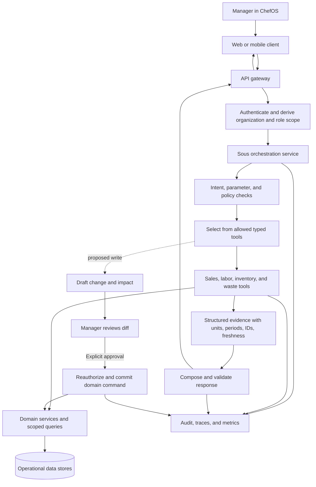

# ChefOS Product Overview

**Target:** ChefOS by Counter Labs, [chefos.us](https://chefos.us/). **Reviewed:** 2026-10-18.
**Basis:** REA captures of public pages. This describes what ChefOS advertises; authenticated product behavior has not been observed. See the [capture record](evidence/2026-10-18-public-site.md).

## What the product is for

ChefOS is presented as an operating system for restaurant operations. It brings **Team**, **Commerce**, and **Inventory** workflows together for restaurant staff, managers, and operators. It is intended to work alongside a restaurant’s existing POS and connected services, replacing disconnected spreadsheets and manual reporting with shared operational information.

The important product outcome is coordinated restaurant work: managers plan labor against demand, teams handle shifts and tasks, operators see sales and cost performance, and inventory activity can inform ordering, menu availability, waste, and food cost. The modules are advertised as connected parts of that operating workflow, not as unrelated record-management pages.

The site says the product supports single and multi-location operators and describes a shared data layer. That is a product claim; the actual tenant model and cross-module behavior remain unverified.

## Product areas

### Team

The public Team page describes demand-informed schedule building, employee and position/station/location management, open shifts, shift trades with manager approval, availability and time-off, tasks, attendance, and compliance. Mobile materials add employee schedule access and change alerts, plus manager visibility into staff, tasks, late clock-ins, and approvals.

The core workflow implied by the site is: managers build and adjust coverage; employees see schedules and submit availability or shift changes; managers review those changes; and daily tasks and attendance help the team execute the shift. Forecast inputs, labor rules, role permissions, and time-clock semantics are unknown.

### Commerce

The site advertises sales, labor, margin, product mix (PMix), channel, daily flash, and variance reporting. The Commerce page capture exposes a date-range sales timeline with daily date controls and weather context. The product is therefore presented as an operating view for understanding performance over time and relating sales patterns to restaurant conditions.

Metric formulas, data sources, business-day cutoffs, reconciliation, and whether weather is used analytically or only displayed are unknown. Sample numbers on the public site are illustrative.

### Inventory

The Inventory page describes stock counts by storage area and unit, count exceptions, pars, ordering and receiving, pack/unit conversion, invoices and accounts payable, transfers, recipes, waste, and stock alerts. Other public copy mentions prep sheets informed by forecasts, 86-list broadcasting, and theoretical-versus-actual variance.

The implied workflow covers the flow of goods through a restaurant: count what is on hand, convert and compare quantities, replenish from suppliers, receive and reconcile deliveries, move stock, connect ingredients to menu items, and record shrink or waste. Exact count-session behavior, purchasing approvals, invoice correction, valuation, and variance calculations are unknown.

### Cross-cutting workflows

- **Waste and yield:** the site advertises tracking by station, shift, and SKU, with shrink analysis and root-cause signals.
- **Sous:** the site advertises natural-language questions, reports and briefings, anomaly detection, suggested actions, and schedule generation. It does not establish which actions are automated, what requires confirmation, or how answers cite source data.
- **Integrations:** the site advertises 48+ connectors spanning POS, payroll/HR, accounting, scheduling/time, inventory/suppliers, delivery, reservations, and communications/identity. Connector availability and data direction are not verified.
- **Mobile:** public copy describes employee self-service, manager shift operations, and mobile inventory tasks such as counts, invoice scans, 86 risk, and follow-ups. The native app has not been inspected.
- **Register and handheld:** the homepage labels this hardware area “Coming soon.”

### Sous production workflow (proposed)

The following is an engineering proposal for a ChefOS-style production assistant, not verified ChefOS behavior. Sous should answer from authorized operational data and expose the evidence and freshness behind each answer. Begin with read-only tools. Treat any write as a separate proposed action that a manager reviews and explicitly approves.

Request lifecycle:

1. The client submits a question and optional view context (for example, a date range). Identity and permissions come from the authenticated session, never from model output or caller-supplied tenant IDs.
2. The API authenticates the user, derives organization/location/role scope, applies request limits, and assigns a request ID.
3. Sous classifies the request and validates extracted parameters against typed schemas and the user's allowed scope. Unsupported or ambiguous requests should be declined or clarified.
4. Policy exposes only approved tools for the intent. Every tool independently checks authorization and calls domain services with tenant-scoped, parameterized queries. The model has no unrestricted SQL or database credentials.
5. Tools return structured facts with units, time window, source references, and data freshness. Deterministic business calculations remain in domain/reporting code where practical.
6. The model composes an explanation from those results. A validator checks the response schema and evidence coverage; missing, stale, or conflicting data is surfaced rather than guessed.
7. The API returns a typed response containing the answer, evidence references, period, freshness, and limitations. The UI can link evidence to source records.
8. For a write request, Sous creates a draft with a diff and impact summary. After explicit user approval, the command path rechecks permissions and current state, validates and commits idempotently, then records the action in the audit trail.

Production concerns include scoped service credentials, secrets management, redaction of sensitive data, bounded timeouts/retries, partial-result handling, rate limits, correlated traces and metrics, and evaluations for correctness, evidence coverage, authorization, refusal/clarification, latency, and cost. Avoid retaining full prompts or sensitive tool results by default. Version tool schemas, prompts, and model choices; stage changes and keep rollback paths. Start with a small set of high-value read tools. Add vector search or multi-agent orchestration only for a demonstrated need.

## What a faithful reconstruction must center

1. The Team, Commerce, and Inventory modules and the work each role performs in them.
2. The operational flows between modules: demand and sales informing labor and prep; recipes linking menu items to ingredients; counts, receipts, transfers, and waste changing stock; and those events informing cost and availability.
3. Restaurant concepts and context such as locations, stations, storage areas, shifts, business dates, units, suppliers, and POS channels where the observed product uses them.
4. The advertised employee and manager mobile workflows, not just a responsive desktop layout.
5. Connected integrations and Sous as product capabilities whose behavior must be learned from evidence, not replaced with invented integrations or a pretend AI assistant.

This is a reconstruction target derived from public descriptions, not a claim that every advertised capability is shipped. The detailed boundary between observed claims, implementation decisions, and unknown behavior is in the [specification](spec.md).

## Public commercial and company context

The pricing page presents Team, Commerce, and Inventory as selectable modules and advertises $200/month for one module, $300 for two, and $450 for all three at one location, with custom multi-location pricing. Terms, limits, and current contract details are unknown. The site identifies ChefOS with Counter Labs / Counter Hospitality Labs, Inc.

## Sources

- [Homepage](https://chefos.us/) — positioning, feature summary, FAQ, and hardware status.
- [Team](https://chefos.us/team) — scheduling and labor claims.
- [Commerce](https://chefos.us/commerce) — analytics page and timeline.
- [Inventory](https://chefos.us/inventory) — stock, purchasing, and inventory claims.
- [Integrations](https://chefos.us/integrations) — connector catalog and API claims.
- [Mobile app](https://chefos.us/mobile-app) — employee, manager, and inventory mobile claims.
- [Pricing](https://chefos.us/pricing) — public module pricing presentation.
- [REA capture record](evidence/2026-10-18-public-site.md) — evidence IDs, method, and capture limits.
- [Proposed Sous architecture](sous-architecture.md) — detailed backend boundary and rollout guidance.
